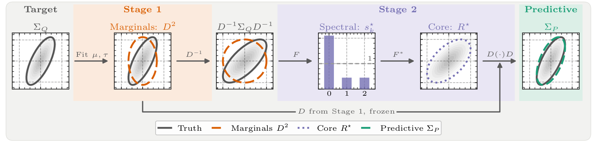

# SCORE: Spectral Correlation Estimation for Multivariate Gaussians

Code for the paper **"SCORE: Spectral Correlation Estimation for Multivariate Gaussians"**.

<!-- TODO: add arXiv link and badge once the pre-print is online -->



Stage 1 fits the mean $\mu$ and the marginal variances $\tau$ (orange) and standardizes the target, leaving only its correlation structure. Stage 2 models this correlation by a normalized
spectrum $s_k^\star$ in Fourier coordinates, whose back-transform ${F}^\ast$ is the correlation core $R^\star$ (purple). Rescaling by the frozen marginals yields the predictive covariance $\Sigma_P$ (green).

## Abstract

Neural network-based predictive modeling with high-dimensional structured Gaussian targets
requires an efficient and numerically stable, yet expressive approximation of the covariance
matrix. We propose SCORE: a scalable framework, combining scoring rule training with an expressive
covariance approximation learned in spectral space. For $d$-dimensional data, the learning task is
decomposed into learning the marginal distributions and learning a structured correlation matrix,
which enables dense dependencies with linear storage and $\mathcal{O}(d \log d)$ cost. We utilize
the closed form Gaussian kernel score for training, which remains defined even for degenerate
covariances and admits bounded gradients during optimization. We characterize kernel scores under
invertible transforms and prove exact invariance under unitary transforms. At population level,
our two-level objective recovers the true marginals and projects the target correlation onto the
representable class; finite-sample PAC bounds show that the errors of the two stages enter
additively. We evaluate our model on a variety of tasks with a commonly assumed Gaussian domain:
Time-series forecasting, monocular depth estimation, and spatial weather prediction, showing
improved performance at lower computational cost.

## Main idea

A network $f_\phi$ maps an input $x$ to a Gaussian $\mathcal{N}(\mu(x), \Sigma_P(x))$ over
$d$ output coordinates. SCORE factors the covariance into marginal scales and a correlation
matrix that is parameterized in the domain of a unitary transform $B$ (by default the DFT
$F$):

$$
\Sigma_P = D_\tau \mathrm{corr}(B^\ast \hat\Sigma B) D_\tau,
\qquad D_\tau = \mathrm{diag}(\sqrt{\tau}).
$$

For the DFT and a diagonal core $\hat\Sigma = \mathrm{diag}(s)$ with $s = d\,\mathrm{softmax}(\ell)$,
the core $F^\ast \mathrm{diag}(s) F$ is already a circulant *correlation* matrix: dense in
physical space, stored with $d$ numbers and applied with the FFT in $\mathcal{O}(d \log d)$.

* **Kernel score instead of the NLL.** All multivariate fits use the closed-form Gaussian kernel
  score. Unlike the log score it is defined for singular covariances and has bounded gradients,
  and it is invariant under unitary transforms, so the correlation can be fitted in spectral
  coordinates without changing the objective.
* **Two-stage fit.** Stage 1 fits $\mu$ and $\tau$ with a univariate score (CRPS). Stage 2
  freezes them and fits the correlation core on the standardized target
  $Z = D_\tau^{-1}(Y - \mu)$. The marginals stay exact whatever the core class, and the core
  only has to model correlation.
* **Beyond the DFT.** Any unitary $B$ works. For station data (EUPPBench) we use the graph
  Fourier transform of a station graph with a Matérn spectral filter, and the code also supports
  DCT/DST/Haar bases and a low-rank correction of the core.

## Repository structure

```
configs/              Hydra configs
  experiments/train/    one file per task; *_score.yaml are the SCORE (two-stage) runs
  method/               predictive heads (score*, diag, lord, cholesky, sample_based, deterministic)
  datamodule/ backbone/ optimizer/ callbacks/ trainer/ paths/ local/
src/
  methods/              covariance parameterizations, scores and samplers
  models/               Lightning module (single-stage and two-stage) and backbones
  datamodules/          time series, ERA5, NYU depth, EUPPBench
  train/                training (train.py) and runtime benchmark (benchmark.py)
  evaluation/           metrics, calibration diagnostics, epoch-budget ablation
  data/                 dataset download / preprocessing scripts
runs/                 SLURM scripts for the experiment sweeps of the paper
notebooks/            figures and tables of the paper
tests/                unit tests (pytest)
tools/                git filter that strips notebook outputs
```

### Methods

| Paper | Description | Config (`method=`) | Class |
|---|---|---|---|
| **SCORE** | two-stage fit, diagonal core in the DFT domain | `score` (via `*_score` experiments) | `src.methods.score.SCORE` |
| SCORE (graph) | graph Fourier transform + Matérn filter (EUPPBench) | `score_matern` | `SCORE` |
| Det | deterministic point forecast, MSE | `deterministic` | `src.methods.deterministic.Deterministic` |
| Diag | diagonal Gaussian | `diag` | `src.methods.diagonal.Diag` |
| LorD | low-rank-plus-diagonal, $\Sigma = D + UU^\top$ | `lord` | `src.methods.lord.LorD` |
| Chol | full Cholesky factor (small $d$ only) | `cholesky` | `src.methods.cholesky.Cholesky` |
| SB | sample-based generative model with noise injection | `sample_based` | `src.methods.sample_based.SampleBased` |

Ablation-only variants: `score_dct`, `score_dct1`, `score_dct4`, `score_dst`, `score_uhaar`,
`score_random` (alternative unitary transforms for the core) and `spectral_diag` (an unnormalized
Fourier-diagonal covariance fitted in a single stage).

Run names and W&B tags use the identifiers of the experiments in the paper (e.g. LorD runs are
named `<dataset>_phys_lora_r1_kernel_score`, SCORE runs `<dataset>_whitened_spectral_diag_kernel_score`);
see `src/utils/legacy.py` for the mapping.

## Installation

Tested with Python 3.12, PyTorch 2.4 and CUDA 11.8.

```bash
conda create -n score python=3.12
conda activate score
pip install torch==2.4.0 --index-url https://download.pytorch.org/whl/cu118   # pick your CUDA build
pip install -r requirements.txt
```

Run all commands from the repository root. Training logs to [Weights & Biases](https://wandb.ai)
by default; add `'~logger'` to disable it, or `logger.wandb.project=<project>` to choose a project.

### Local settings

Data locations are set in [configs/paths/default.yaml](configs/paths/default.yaml) and default to
`./data/...`. To use data stored elsewhere, copy the template and edit it:

```bash
cp configs/local/default.yaml.example configs/local/default.yaml   # git-ignored, loaded automatically
cp runs/env.sh.example runs/env.sh                                 # optional, sourced by the SLURM scripts
```

## Data

| Task | Location (`paths.*`) | How to obtain |
|---|---|---|
| Time series (ETTh1/2, ETTm1/2, Weather, Electricity, Traffic, ILI) | `time_series_dir` | The six benchmark folders distributed with [Autoformer](https://github.com/thuml/Autoformer) (`ETT-small/`, `electricity/`, `traffic/`, `weather/`, `illness/`, `exchange_rate/`). |
| ERA5 surface temperature | `era5_dir` | `python src/data/download_era5.py --out data/era5/` (WeatherBench2, needs `gcsfs`), then `python src/data/era5_statistics.py --data_path data/era5/` for the training-period normalization. |
| NYU Depth v2 (Eigen crop) | `nyu_bts_dir` | Download the [BTS](https://github.com/cleinc/bts) sync set and file list plus the labeled set and `splits.mat` from [NYU Depth v2](https://cs.nyu.edu/~fergus/datasets/nyu_depth_v2.html), then `python src/data/build_nyu_bts.py --src <download> --out data/nyu_bts --crop`. |
| Depth Anything V2 weights | `depthanything_checkpoint`, `dinov2_dir` | [Depth-Anything-V2-Small](https://huggingface.co/depth-anything/Depth-Anything-V2-Small) checkpoint and a clone of [facebookresearch/dinov2](https://github.com/facebookresearch/dinov2). |
| EUPPBench stations | `euppbench_dir` | The EUPPBench station zarr stores ([Demaeyer et al., 2023](https://doi.org/10.5194/essd-15-2635-2023)), then `python src/data/build_euppbench.py --data_path <stores> --lead_time 72h`. |

## Training

Each run selects an experiment (task and backbone) and, for the baselines, a method. Test
metrics (MSE, CRPS, ES, KS, VS, NLL) are computed on the best validation checkpoint at the end of
training and written to the run log and to W&B.

```bash
# SCORE on univariate ETTh1, horizon 96
python src/train/train.py experiments=train/time_series/univariate/etth1_score

# baselines on the same task
python src/train/train.py experiments=train/time_series/univariate/etth1 method=diag method.loss=kernel_score
python src/train/train.py experiments=train/time_series/univariate/etth1 method=lord method.rank=1 method.loss=nll
python src/train/train.py experiments=train/time_series/univariate/etth1 method=sample_based

# horizon, seed and multirun sweeps are ordinary Hydra overrides
python src/train/train.py -m experiments=train/time_series/multivariate/etth2_score \
    datamodule.pred_len=96,192 seed=1,2,3,4,5
```

Other tasks: `experiments=train/era5[_score]`, `train/depth[_score]`, `train/euppbench[_score]`,
and `train/time_series/multivariate/{etth1,etth2,ettm1,ettm2,weather,electricity,traffic,illness}[_score]`.
Checkpoints and logs are written to `logs/train/runs/<timestamp>/` (`checkpoints/stage1`,
`checkpoints/stage2` for SCORE).

## Reproducing the paper

The sweeps used in the paper (all methods, losses, ranks, horizons and five seeds) are the SLURM
scripts in [runs/](runs/); they run unchanged with `bash` on a single machine.

| Paper | Script |
|---|---|
| Tables 3, 4 and H.1 (all tasks) | `runs/train/{etth1,etth2,ettm1,ettm2}_{uni,multi}.sh`, `runs/train/illness.sh`, `runs/train/euppbench.sh`, `runs/train/era5.sh`, `runs/train/era5_score.sh`, `runs/train/sample_based.sh` |
| Runtime (Fig. 4, App. H.2) | `runs/benchmark.sh`, `runs/benchmark_traffic.sh` (`src/train/benchmark.py`) |
| Calibration (Fig. 5, App. H.3) | `runs/calibration.sh` (`src/evaluation/calibration.py`) |
| Epoch budget (App. H.4) | `runs/epoch_budget.sh`, `runs/epoch_budget_graph.sh` (`src/evaluation/epoch_budget.py`) |

Figures and tables are produced by the notebooks in [notebooks/](notebooks/), which read the
trained runs from `paths.results_dir` (one folder per configuration and seed) and, for the rank
tables, from W&B. They write to `notebooks/figures/` and `notebooks/tables/`.

| Notebook | Produces |
|---|---|
| `theoretical_visualizations.ipynb` | Fig. 1 |
| `collapse_experiment.ipynb` | Fig. 2 and App. F (toy example) |
| `analyze_euppbench_predictions.ipynb`, `analyze_ts_predictions_univariate.ipynb` | Fig. 3 |
| `analyze_results_tables.ipynb` (+ `make_results_tables.py`, `make_task_tables.py`) | Tables 3, 4 and the per-task tables |
| `runtime_analysis.ipynb` (+ `make_runtime_table.py`) | Fig. 4 and the runtime tables |
| `calibration_histograms.ipynb` | Fig. 5 and App. H.3 |
| `ablations.ipynb`, `epoch_budget.ipynb` | App. H.4 |
| `paper_depth_results.ipynb`, `analyze_*_predictions.ipynb` | per-task analyses in App. H |

## Tests

```bash
pytest -m "not realdata"     # unit tests, no datasets needed
pytest -m realdata           # smoke tests against the real datasets (configured paths)
```

## License

This code is released under the [MIT License](LICENSE), except for
`src/models/backbones/ucast.py`, which is adapted from NVIDIA's EDM code and remains under
CC BY-NC-SA 4.0 (non-commercial). Other adapted backbones keep their original license
headers; see [LICENSE](LICENSE) for details.

## Citation

```bibtex
@article{score2026,
  title  = {{SCORE}: Spectral Correlation Estimation for Multivariate Gaussians},
  author = {TODO},
  year   = {2026},
  note   = {TODO: arXiv identifier}
}
```
